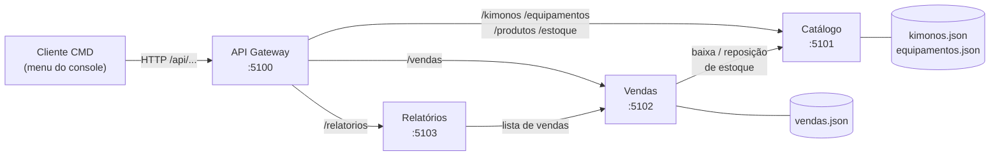

# Arte Suave Store: versão em microserviços

Esta pasta traz a loja de Jiu-Jitsu do projeto monolítico (`../Sistema Monolitico E-commerce/`) reescrita como **microserviços**. As funcionalidades e o menu no CMD são os mesmos. O que muda é que a regra de negócio e os dados saíram do `Program.cs` único e foram divididos em serviços independentes, que conversam por **HTTP/JSON**.

Feito em **.NET 9** com **ASP.NET Core Minimal APIs**, sem nenhum pacote NuGet.

## Arquitetura



| Projeto | Porta | Responsabilidade | Dados próprios |
|---|---|---|---|
| `ArteSuave.Gateway` | 5100 | Ponto único de entrada. Encaminha `/api/<recurso>` ao serviço dono do recurso e agrega a saúde de todos em `/api/saude` | nenhum |
| `ArteSuave.Catalogo.Api` | 5101 | Cadastro, consulta e exclusão de kimonos e equipamentos, e controle do estoque | `kimonos.json`, `equipamentos.json` |
| `ArteSuave.Vendas.Api` | 5102 | Registra as vendas. Pede ao Catálogo a baixa do estoque antes de gravar | `vendas.json` |
| `ArteSuave.Relatorios.Api` | 5103 | Relatório de vendas com total por categoria e total geral | nenhum (consulta Vendas) |
| `ArteSuave.Cliente.Cmd` | – | O menu do monólito. Só faz chamadas HTTP ao Gateway | nenhum |
| `ArteSuave.Compartilhado` | – | Contratos (DTOs), endereços dos serviços e cliente HTTP | – |
| `ArteSuave.Infra` | – | Base dos serviços web: log das requisições, erros em JSON, `/saude` e arquivo JSON | – |

### Conceitos de microserviços aplicados

- **Banco de dados por serviço.** Cada serviço grava na sua própria pasta (`dados/catalogo`, `dados/vendas`) e nenhum outro abre esses arquivos. Quem precisa do dado pede por HTTP. Por exemplo, Vendas não sabe onde fica o estoque: só chama `POST /estoque/baixa` no Catálogo.
- **API Gateway.** O cliente conhece um único endereço. O Gateway tem uma tabela de roteamento (`kimonos` → Catálogo, `vendas` → Vendas, …) e repassa método, corpo e status sem alterar nada.
- **Saga com compensação.** Uma venda envolve dois serviços. Vendas primeiro baixa o estoque no Catálogo e depois grava a venda. Se a gravação falhar, chama `POST /estoque/reposicao` para devolver o que foi baixado. Assim nenhum produto some do estoque sem uma venda registrada.
- **Isolamento de falhas.** Se um serviço cai, os outros continuam no ar. Com o Catálogo desligado, por exemplo, o relatório de vendas continua funcionando, e cadastro e venda respondem `503` com uma mensagem clara. A opção **6 - Status dos Serviços** do menu mostra quem está no ar.
- **Health check.** Todo serviço responde `GET /saude`, e o Gateway consulta todos em paralelo em `GET /api/saude`.
- **Configuração por ambiente.** Os endereços vêm de variáveis de ambiente (`ARTESUAVE_GATEWAY_URL`, `ARTESUAVE_CATALOGO_URL`, `ARTESUAVE_VENDAS_URL`, `ARTESUAVE_RELATORIOS_URL`), então cada serviço pode rodar em outra máquina. `ARTESUAVE_DADOS` troca a pasta dos arquivos.
- **Concorrência.** Os serviços atendem requisições em paralelo. Cada repositório protege as listas com `lock`, altera uma cópia e só troca a lista depois que o arquivo foi gravado. A gravação passa por um arquivo temporário, para não corromper os dados se o processo cair no meio.

## Como rodar

Requisito: [.NET SDK 9](https://dotnet.microsoft.com/download/dotnet/9.0).

**Jeito mais fácil:** dê dois cliques em `iniciar.bat`. Ele compila a solução, abre uma janela para cada serviço (com o log das requisições) e, por último, abre o menu da loja.

**Pelo Visual Studio 2022:** abra `ArteSuave.Microservicos.sln`, clique com o direito na solução, vá em *Configurar Projetos de Inicialização*, escolha *Vários projetos de inicialização* e marque como *Iniciar* os quatro serviços e o `ArteSuave.Cliente.Cmd`.

**Pelo terminal**, um comando por janela:

```powershell
dotnet run --project src/ArteSuave.Catalogo.Api
dotnet run --project src/ArteSuave.Vendas.Api
dotnet run --project src/ArteSuave.Relatorios.Api
dotnet run --project src/ArteSuave.Gateway
dotnet run --project src/ArteSuave.Cliente.Cmd
```

Para subir só os serviços e testar a API: `.\iniciar.ps1 -SemCliente`.

## API

Todas as rotas passam pelo Gateway (`http://localhost:5100`). Cada serviço também pode ser chamado direto na porta dele, sem o prefixo `/api`.

| Método | Rota | Serviço | Descrição |
|---|---|---|---|
| GET | `/api/saude` | Gateway | Status de cada serviço |
| GET | `/api/estoque` | Catálogo | Kimonos e equipamentos |
| GET | `/api/kimonos` · `/api/equipamentos` | Catálogo | Lista por tipo |
| POST | `/api/kimonos` · `/api/equipamentos` | Catálogo | Cadastra (`201`; `400` dado inválido; `409` nome repetido) |
| GET | `/api/produtos/{nome}` | Catálogo | Busca por nome, sem diferenciar maiúsculas (`404` se não existe) |
| DELETE | `/api/kimonos/{nome}` · `/api/equipamentos/{nome}` | Catálogo | Exclui (`204`) |
| POST | `/api/estoque/baixa` · `/api/estoque/reposicao` | Catálogo | Movimenta estoque (usado pelo serviço de Vendas) |
| GET | `/api/vendas` | Vendas | Lista as vendas |
| POST | `/api/vendas` | Vendas | Realiza a venda (`201`; `404` produto inexistente; `409` estoque insuficiente) |
| GET | `/api/relatorios/vendas` | Relatórios | Vendas, total por categoria e total geral |

Exemplos (PowerShell):

```powershell
Invoke-RestMethod -Method Post http://localhost:5100/api/kimonos -ContentType 'application/json' `
  -Body '{"nome":"Kimono Atama Mundial","cor":"Azul","tamanho":"A2","quantidade":5,"preco":599.90}'

Invoke-RestMethod -Method Post http://localhost:5100/api/vendas -ContentType 'application/json' `
  -Body '{"tipo":"kimono","nome":"Kimono Atama Mundial","quantidade":2}'

Invoke-RestMethod http://localhost:5100/api/relatorios/vendas
```

Erros sempre voltam no formato `{"mensagem": "..."}` com o status HTTP adequado: `400` dado inválido, `404` não encontrado, `409` conflito (estoque insuficiente ou nome repetido), `503`/`504` serviço fora do ar ou sem resposta.

## Do monólito para os microserviços

| No monólito (`Program.cs`) | Na versão em microserviços |
|---|---|
| `struct Kimono`, `Equipamento`, `Venda` | `ArteSuave.Compartilhado/Contratos.cs` (records trocados em JSON) |
| `listaKimonos`, `listaEquipamentos`, `SalvarKimonos()`, `CarregarEquipamentos()`… | `ArteSuave.Catalogo.Api/RepositorioCatalogo.cs` |
| `CadastrarKimono()`, `CadastrarEquipamento()` | Validação no Catálogo (`POST /kimonos`, `POST /equipamentos`) + tela no cliente |
| `RealizarVendaKimono()`, `RealizarVendaEquipamento()` | `ArteSuave.Vendas.Api/RegistroDeVendas.cs` + baixa de estoque no Catálogo |
| `listaVendas`, `SalvarVendas()`, `CarregarVendas()` | `ArteSuave.Vendas.Api/RepositorioVendas.cs` |
| `MenuConsultarExcluir()` | `GET /produtos/{nome}` e `DELETE` no Catálogo |
| `ImprimirRelatorioVendas()` (soma por categoria) | `ArteSuave.Relatorios.Api` |
| Menus, `LerInteiroPositivo()`, mensagens coloridas | `ArteSuave.Cliente.Cmd/Program.cs` |
| Arquivos `.txt` separados por `\|` | Arquivos `.json`, um conjunto por serviço |

Mudanças de comportamento em relação ao monólito:

- O nome identifica o produto, então não dá mais para cadastrar dois produtos com o mesmo nome (antes a venda e a exclusão sempre pegavam o primeiro). O Catálogo responde `409`.
- Nome, cor, tamanho e categoria não podem ficar em branco.
- Cada venda agora guarda também um `id` e a data/hora.
- Novo item no menu: **6 - Status dos Serviços**.
